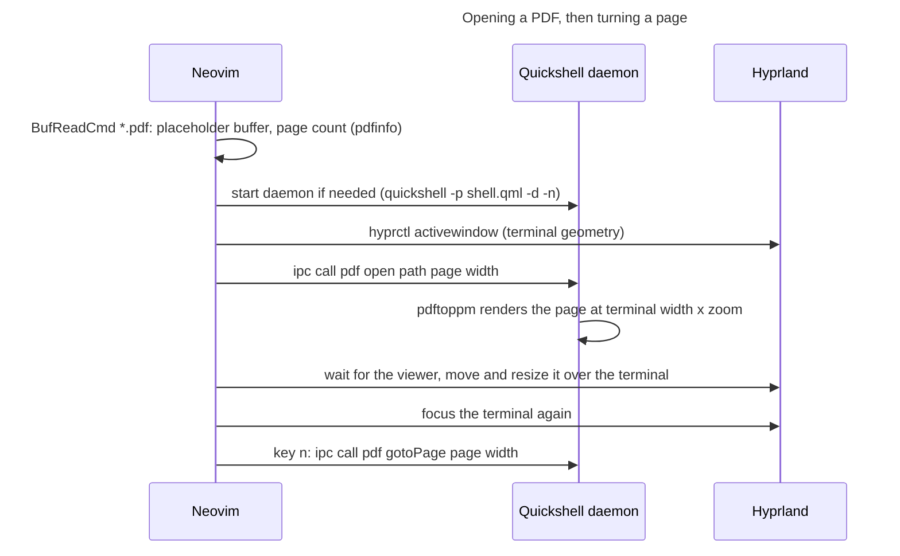

# quickpdf.nvim

Read PDFs from Neovim without leaving the terminal. Opening a `.pdf` shows the
page in a [Quickshell](https://quickshell.org) window that Hyprland places
exactly over your terminal. You flip pages, zoom and pan with Neovim keymaps;
keyboard focus stays in Neovim the whole time.

The page is a real compositor window, not terminal graphics drawn inside the
buffer, so it does not flicker or vanish when the Neovim layout changes
(winbar, command line height, number column).

## Contents

- [Requirements](#requirements)
- [Installation](#installation)
- [Usage](#usage)
- [Configuration](#configuration)
- [How it works](#how-it-works)
- [Limitations](#limitations)
- [Troubleshooting](#troubleshooting)
- [Contributing](#contributing)
- [License](#license)

## Requirements

- Linux with [Hyprland](https://hyprland.org) (the plugin calls `hyprctl`)
- Neovim 0.10 or newer (0.12 if you install with `vim.pack`)
- [Quickshell](https://quickshell.org), with `quickshell` on your `$PATH`
- `poppler-utils`, for `pdftoppm` and `pdfinfo`
- `pgrep` and `kill` (procps), used to clean up stray viewer processes

## Installation

With `vim.pack` (Neovim 0.12):

```lua
vim.pack.add({ "https://github.com/YacineIdir/quickpdf.nvim" })
require("quickpdf").setup()
```

With [lazy.nvim](https://github.com/folke/lazy.nvim):

```lua
{ "YacineIdir/quickpdf.nvim", opts = {} }
```

### Hyprland window rule (recommended)

Add this rule to `hyprland.conf` so the viewer floats and never takes keyboard
focus:

```ini
windowrule {
    name = quickshell-pdf-viewer
    match:title = ^(quickshell-pdf-viewer)$

    float = yes
    no_focus = true
    no_shadow = true
}
```

Then run `hyprctl reload`.

Without the rule, the plugin toggles the window to floating itself and gives
focus back to the terminal a few times after the window appears. That usually
works, but it can lose the race and leave focus on the viewer.

## Usage

Open any PDF with `:e file.pdf` or from a file explorer. The viewer appears
over the terminal with the same position and size. Leaving the buffer hides
the viewer, coming back shows it again, and quitting Neovim stops it.

Default keymaps, in normal mode inside the PDF buffer:

| Key             | Action        |
| --------------- | ------------- |
| `n`             | Next page     |
| `p`             | Previous page |
| `z`             | Zoom in       |
| `q`             | Zoom out      |
| `e`             | Reset zoom    |
| `h` `j` `k` `l` | Pan           |

The winbar shows the file name, `page x/y` and the zoom level. Zooming keeps
the visible part of the page in place. The mouse wheel also scrolls the
viewer.

## Configuration

`setup()` takes an optional table. These are the defaults:

```lua
require("quickpdf").setup({
    qs_config = nil, -- directory containing shell.qml; nil uses the bundled one
    keymaps = {
        next_page = "n",
        prev_page = "p",
        zoom_in = "z",
        zoom_out = "q",
        zoom_reset = "e",
        pan_left = "h",
        pan_right = "l",
        pan_up = "k",
        pan_down = "j",
    },
    zoom_step = 0.1,     -- zoom change per key press (0.1 = 10 %)
    min_zoom = 0.2,      -- lowest zoom allowed
    pan_fraction = 0.25, -- share of the window moved per pan key press
    winbar = true,       -- show page and zoom in the winbar
})
```

Set a keymap to `false` to disable it. For example, to keep `q` for macros:

```lua
require("quickpdf").setup({ keymaps = { zoom_out = "Z" } })
```

## How it works

Neovim owns the navigation state (page, zoom). A Quickshell daemon owns the
window and draws the page. They talk through Quickshell IPC, and `hyprctl`
places the window over the terminal.



The page is rendered at the exact pixel width it is shown at, so zoom is a
re-render, not an image scale. Fast repeated key presses are merged in QML so
renders never pile up.

More diagrams are in [docs/architecture.md](docs/architecture.md), the
project vocabulary in [GLOSSARY.md](GLOSSARY.md), and design decisions in
[docs/adr/](docs/adr/).

Code layout:

| Path                              | Role                                     |
| --------------------------------- | ---------------------------------------- |
| `lua/quickpdf/init.lua`           | `setup()` and autocommands               |
| `lua/quickpdf/config.lua`         | Default options and merging              |
| `lua/quickpdf/viewer.lua`         | Per-buffer state, actions, show and hide |
| `lua/quickpdf/ui.lua`             | Placeholder buffer, winbar, keymaps      |
| `lua/quickpdf/daemon.lua`         | Quickshell process lifecycle and IPC     |
| `lua/quickpdf/hyprland.lua`       | `hyprctl` calls: geometry and focus      |
| `lua/quickpdf/process.lua`        | Runs every external program              |
| `quickshell/pdf_viewer/shell.qml` | Viewer window, rendering, `pdf` IPC      |

## Limitations

- Hyprland only. Other compositors are not supported yet.
- The viewer covers the whole terminal window, not only the Neovim split that
  holds the PDF.
- One viewer at a time: two Neovim instances share the same daemon, and
  quitting one of them closes the viewer of the other.
- Rendering and window placement run synchronously, so opening a PDF can
  block Neovim for up to a few seconds on a slow machine.

## Troubleshooting

**`quickpdf: Quickshell daemon did not come up`.** Check that the daemon
starts by hand:

```bash
quickshell -p ~/path/to/quickpdf.nvim/quickshell/pdf_viewer
```

Errors in `shell.qml` or a missing Quickshell module show up in that output.
Stop it with `Ctrl-C` before going back to Neovim: two running copies make
every IPC call fail.

**The viewer takes keyboard focus or does not float.** Install the
[Hyprland window rule](#hyprland-window-rule-recommended) and run
`hyprctl reload`.

**The page stays blank.** Check that `pdftoppm` is installed and that the file
opens with `pdftoppm -png -f 1 -l 1 file.pdf /tmp/test`.

## Contributing

Issues and pull requests are welcome. Planned work is tracked on the
[GitHub issues](https://github.com/YacineIdir/quickpdf.nvim/issues) page.

Development happens on `develop`; `main` holds released versions. Name
branches `<type>/<short-description>` (`feature/`, `fix/`, `docs/`,
`refactor/`, `chore/`) and write commits as
`<type>(<scope>): <description>` in English.

To work on the plugin, point your plugin manager at your local clone (for
lazy.nvim, `{ dir = "~/path/to/quickpdf.nvim", opts = {} }`) and restart
Neovim after each change.

### Tests

```bash
make test                          # whole suite
make test TESTS=tests/test_ui.lua  # one file
```

`make test` clones [mini.nvim](https://github.com/echasnovski/mini.nvim)
into `deps/` on first run and executes every `tests/test_*.lua` in a headless
child Neovim. It needs neither Hyprland nor Quickshell: `tests/fakes/` puts
stand-ins for `hyprctl`, `quickshell`, `pdfinfo`, `pgrep` and `kill` first on
`PATH`, each recording the exact command line it receives so tests can assert
it. The command exits non-zero as soon as one case fails.

## License

[MIT](LICENSE)
