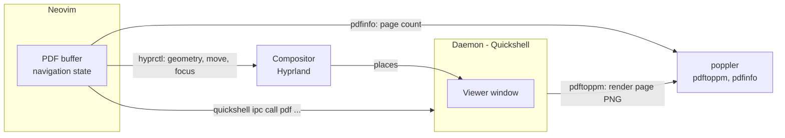
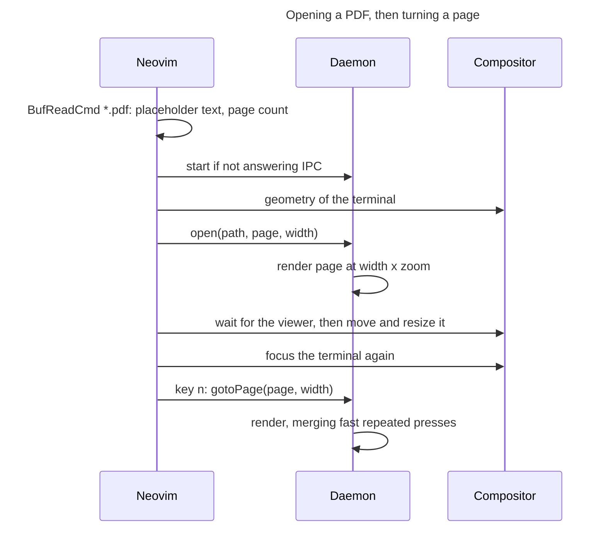
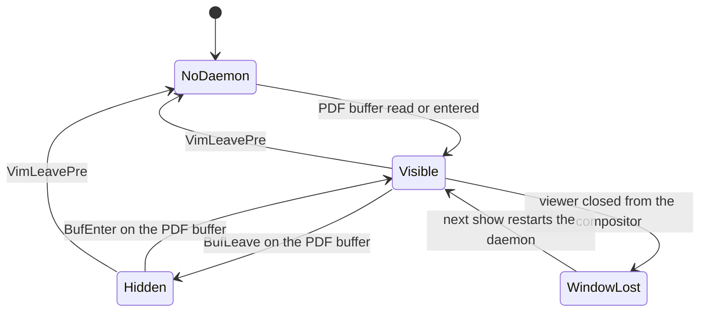
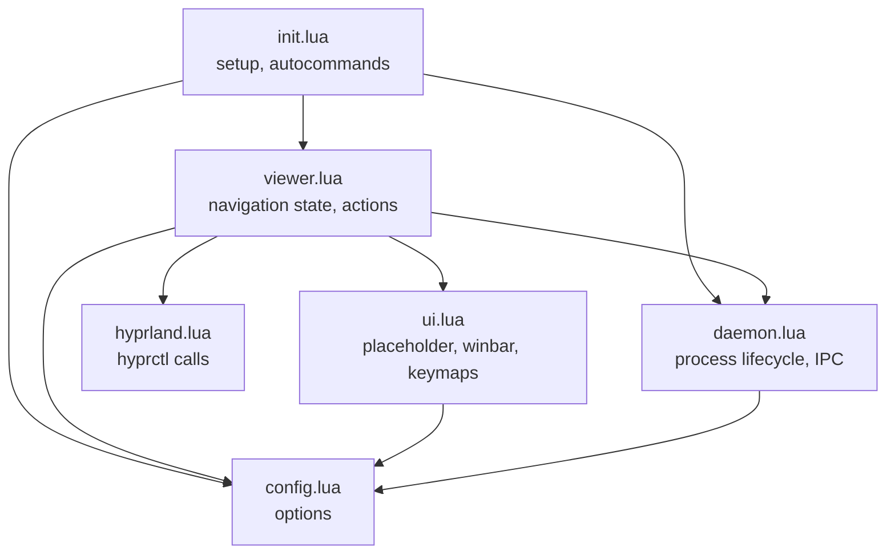

# Architecture

How quickpdf.nvim is put together. Terms are defined in
[GLOSSARY.md](../GLOSSARY.md); decisions and their reasons are in
[docs/adr/](adr/).

## Contents

- [Components](#components)
- [Opening a PDF](#opening-a-pdf)
- [Viewer lifecycle](#viewer-lifecycle)
- [Lua modules](#lua-modules)

## Components

Neovim owns the navigation state and decides what to show. The daemon owns
the viewer and renders pages. The compositor places the viewer.

## Opening a PDF

## Viewer lifecycle

## Lua modules

`ui.lua` does not require `viewer.lua`: the viewer passes its actions to
`ui.keymaps()`, so there is no dependency cycle.
